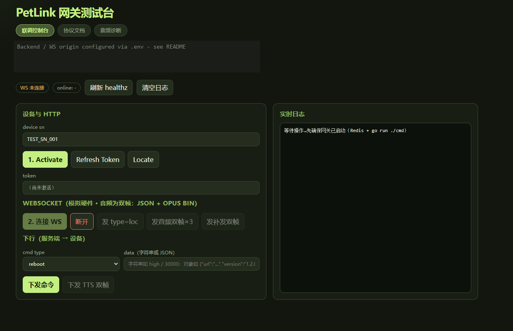
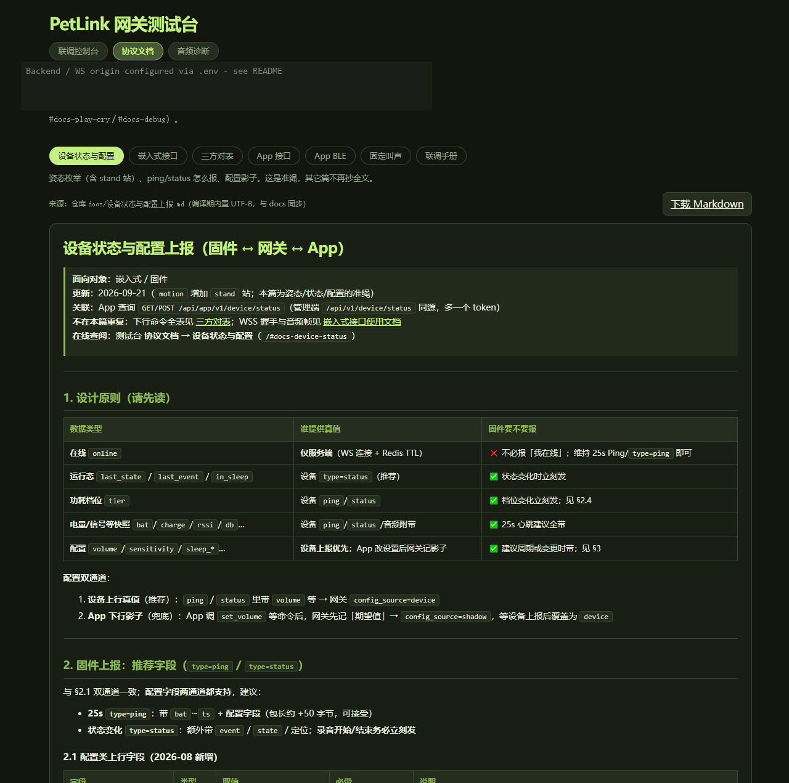
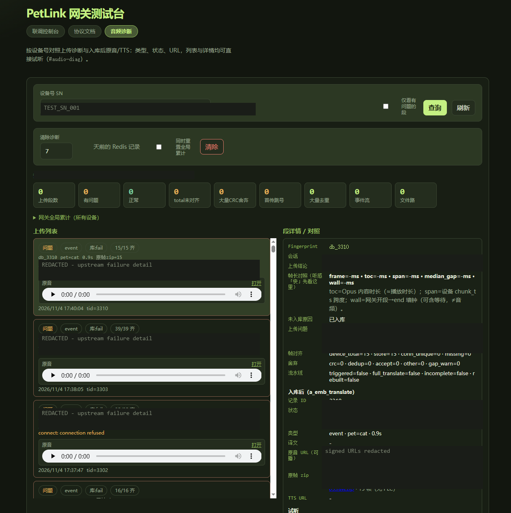

# PetLinkGateway — Real-Time IoT Translation Gateway in Go

> A production WebSocket gateway for embedded translation devices: secure device handshake, binary OPUS audio streaming with deduplication and retransmission, online-state management, OTA, Wi-Fi fingerprint location, and an optional OSS → AI → TTS translation pipeline. Built end-to-end by one engineer.

`Go 1.22` · `WebSocket/WSS` · `Redis` · `Kafka` · `gorilla/websocket` · `zap` · `viper` · `TLS` · `ffmpeg/Opus`

---

## The problem

An embedded translation device records voice and streams it to the cloud over home Wi-Fi — a lossy, high-frequency, long-lived connection. The gateway must authenticate each device, keep thousands of sockets alive, accept 60 ms OPUS fragments, survive reconnects and retransmits without duplicating audio, downlink synthesized speech back to the device, and support OTA and remote configuration — all without blocking the read loop.

## What it does

- **Connection management** (`internal/gateway/`): WSS handshake with `X-Device-SN` / `X-Device-Token`, 25 s device heartbeat with an 8 s server-side liveness timeout, per-device rate limiting (20 msg/s), old-connection eviction on re-entry, and clean SIGINT/SIGTERM shutdown.
- **Binary hybrid-frame protocol**: each audio fragment is a JSON metadata frame (`sn/type/codec/seq/total/end/pid/bat/charge/ts/crc/...`) plus one raw OPUS frame. CRC32 validation, absolute-microsecond timestamp normalization, and a **deduplication key built from `sn + seq + absolute timestamp + CRC`** — so a retransmitted fragment after reconnect maps to the same bucket instead of being inserted twice (`dedup_key.go`, with unit tests).
- **Retransmission & offline commands**: explicit `type=retransmit` frames are reconciled against the live session segment; commands sent to offline devices are queued in Redis and flushed on reconnect.
- **Async persistence**: the read goroutine only validates CRC and dedups, then hands off to a separate channel for database/Kafka writes — audio I/O never blocks the socket loop.
- **Device APIs**: activation/token refresh, Wi-Fi fingerprint → coordinates location resolution, firmware version check with HTTP `Range` resume download, and firmware OTA with ~10 s config hot-reload.
- **Translation pipeline** (`internal/pipeline/`, `internal/ai/`, `internal/baidu/`, `internal/oss/`): when enabled, uploaded audio goes OSS → AI translation → text-to-speech → OPUS encoding → serialized per-device TTS queue → device playback. Each external provider can be disabled independently; the gateway still works as a pure connection/forwarding layer.
- **Observability**: structured `zap` logging with per-session diagnostics (drop reasons: CRC / dedup / accept / other), a browser-based test console (`web/test-console`), and a health endpoint.

## Operator console

A React/Vite front-end in `web/test-console/` lets an engineer drive the whole protocol from a browser instead of hand-crafting packets: activate a device and refresh its token, open the WSS session, send location/audio twin-frames, trigger retransmission, push commands and TTS downlink, inspect live logs, and audit per-device uploads with drop-reason counters and playable original audio. It also renders the protocol docs from `docs/` in-page.

Screenshots (sensitive values redacted):

| Function | View |
|---|---|
| Connection / command console |  |
| In-page protocol documentation |  |
| Audio diagnostics — drop reasons & replay |  |

To run it locally: `cd web/test-console && npm install && npm run dev`, then open `http://localhost:5173`. It connects to the gateway on the same host by default; set `VITE_GATEWAY_ORIGIN` in `.env.local` to point at another instance. No credentials are required to view the UI — activation and commands still require a running gateway.

## Architecture

```
Device (ESP32 / embedded)
   │  WSS /ws  ── handshake(SN+Token) ──▶ ConnManager
   │  ── JSON meta + raw OPUS frame ───▶  CRC → dedup → async channel
   │                                          │
   │                                          ├─▶ Redis  (auth / online / offline cmds / TTS queue)
   │                                          ├─▶ Kafka  (audio / location topics)
   │                                          └─▶ Pipeline: OSS → AI translate → TTS → OPUS
   │  ◀── cmd / TTS frames / notify ───────────┘
   │
HTTP API  ── activation / location / firmware / OTA / status / admin
```

## Protocol notes

- Metadata and binary are **two separate frames**; one binary frame = exactly one OPUS packet (60 ms recommended). No Ogg container, no multi-packet batching.
- Timestamps use **Unix microseconds**; relative offsets are only valid for `seq > 0` within a segment.
- Deduplication uses the **absolute** segment-anchored timestamp and deliberately excludes `total` (a cumulative counter, not a stable bucket key) — the reasoning is documented and unit-tested in `dedup_key_test.go`.

## Run locally

```bash
cp config/config.example.yaml config/config.yaml   # fill in your own Redis/credentials
# optional: bash scripts/gen_certs.sh               # self-signed TLS for local WSS
go mod tidy
go run ./cmd -config ./config/config.yaml

# simulate a device (handshake → location → OPUS fragments → retransmit → downlink)
go run ./cmd/demo_client -host wss://127.0.0.1:8443/ws \
  -sn TEST_SN_001 -token test-token-001 -insecure
```

Kafka and the translation pipeline are **disabled by default**, so the gateway runs with just Go + Redis. Full protocol docs, deployment notes and the chip/firmware interface spec are in [`docs/`](./docs/) and [`README.zh-CN.md`](./README.zh-CN.md).

## Tech notes / tradeoffs

- **Why a thin gateway?** It deliberately does not decode audio or write business logic. Connection state, protocol translation and backpressure belong here; audio assembly and AI calls belong downstream. This keeps the hot path predictable under high-frequency fragments.
- **Why dedup on absolute time, not `total`?** `total` increments on every send, so a retransmitted fragment would land in a different bucket. Anchoring to the segment start makes live and retransmitted frames comparable.
- **Why a separate persistence channel?** A slow database or Kafka broker must not stall the socket read loop or inflate the heartbeat timeout.
- **Honest scope:** the gateway owns connection management and message forwarding. ASR/translation/TTS are external services wired behind a provider abstraction — I integrated and orchestrated them, I did not train models.

---

*Designed and implemented solo: protocol, connection layer, dedup/retransmit logic, device APIs, AI/TTS pipeline integration, deployment tooling and test console — iterated against real firmware.*
