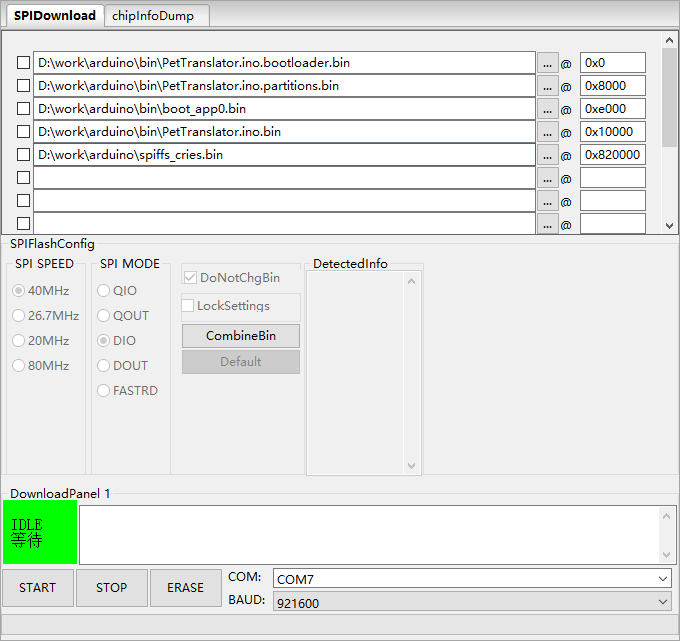

# 嵌入式设备接口使用文档（服务端）

> 面向对象：固件 / 嵌入式开发  
> 协议版本：`proto_ver`（当前建议填 `1`）  
> 传输：**HTTPS + WSS（TLS）**；测试环境经反向代理，**URL 不带端口**  
> 测试基址：`https://api.example.com`  
> 说明：本文只描述**设备侧必须对接**的接口；App、后台管理接口不在此列。  
> 更新：2026-09-21（`motion` 增加 `stand` 站；状态上报细节改指《设备状态与配置上报》，烧录见 §11）  
> 在线查阅：测试台 **协议文档 → 嵌入式接口**（`/#docs`）  
> 分工：设备对接看本文；姿态/状态/配置以 [设备状态与配置上报](./设备状态与配置上报.md) 为准；命令对表看 [三方对表](./三方对表-命令与上报.md)；App 拉音频看 [App音频查询接口](./App音频查询接口.md)。固定叫声、联调步骤各自独立成篇，不再抄进本文。

---

## 0. 字段与联调约定（必读）

| 约定 | 要求 |
|------|------|
| 字段名 | **一律 snake_case**，不要混驼峰 |
| 枚举 | 多数用英文字符串；**例外：`loc_type` 用数字，`1`=wifi**（入站仍兼容旧 `"wifi"`） |
| 布尔 | 开关类字段用 **`0` / `1`**（如 `end`/`bound`）；**`charge` 例外：用 `true` / `false`** |
| 充电状态 | 音频附带：`charge`=`true`/`false`；**独立充电上报**：BLE STAT `CHARGE:<0-100>` |
| 编码 | 每帧带 `codec`：`0`/`opus` 或 `1`/`mp3`（云端兼容数字与字符串） |
| 宠物档案 | 每帧带 `pid`（**字符串，强制纯数字整型串，如 "123"**）；未绑定填 `""`。旧占位 `4294967295` / `"FFFFFFFF"` 视为未绑定兼容。帧内 `pid` 空时可由 `a_emb_sn` 补齐；若 **`a_emb_sn.bind_user_id` / `bind_pet_id` 为空或 0**，网关拒收该设备录音。禁止发送 `pet_` 前缀字符串（会被拒绝）。 |
| 时间戳 | **定稿方案 A**：`ts` = NTP 锚定的 **Unix 微秒**（上电单调微秒拼入）；**禁止**裸 32 位毫秒（约 49.7 天回绕）。段内 seq>0 可发相对段首的偏移微秒 |
| 加密 | **联调阶段关闭**，明文传音频；正式密钥由 MAC/SN 派生，不上行帧带密钥 |
| 协议版本 | 建议段首帧带 `proto_ver`（整数），便于以后兼容 |

去重指纹（实时与补发共用）：**`sn` + `seq` + `total` + `ts`（绝对 Unix 微秒）**。补发缺字段时服务端会尽量回填；仍缺则降级用 `sn+seq+crc`。

### 时间戳定稿（方案 A，音频 / 动作共用）

| 项 | 约定 |
|----|------|
| 选用 | **A) NTP 墙钟 + 上电以来微秒 → 拼成一个 int64 Unix 微秒** |
| 不用 | B) 裸 32 位毫秒（会回绕）；C) `time()` **秒级**；D) 拆成两个 32 位字段 |
| 设备算法 | `unix_us = ntp_unix_us_at_sync + (uptime_us_now - uptime_us_at_sync)`（NTP 若只有毫秒，先 `×1000` 再算） |
| 音频 seq=0 | `ts` = 绝对 Unix **微秒**（64 位整数，JSON number） |
| 音频 seq>0 | **同一键名** `ts` = 相对**本段**第一块的偏移**微秒**（例：60ms 帧 → `60000`） |
| 补发 | `ts` = 该片绝对 Unix 微秒（与首次一致） |
| imu[].ts / loc_ts / notify.ts | 同一时间基：绝对 Unix 微秒，便于与音频波形对齐 |
| 云端 | 入库 / Kafka 的 `ts` 一律归一为绝对 Unix 微秒；相对偏移只在接入层换算 |

#### 帧格式对表确认（云端回复固件「待定」四条）

| 待定项 | 云端确认 | 不接受 |
|--------|----------|--------|
| 绝对时间戳形态 | **单个 64 位整数**（JSON `number`） | 拆成两个 32 位 |
| 绝对时间单位 | **Unix 微秒**（约 16 位十进制，如 `1720000000000000`） | Unix **毫秒** / **秒**（`time(nullptr)`） |
| 相对偏移 | 仍放在 **`ts`**，单位 **微秒**（32 位无符号即可覆盖很长一段；JSON 不必另开字段） | 新键 `offset_ms`；相对用毫秒（与 imu 微秒基不一致） |
| JSON 键名 | 只认 **`ts`** | `timestamp` / `time` |
| 「首块」界定 | **每次音频段的 `seq=0`**（一段叫声/一段录音的第一片） | 「每次 WS 连接后的第一个音频包」——同连接多段会丢绝对锚点 |

**不要用「连接首包绝对 + 之后全程相对」**：一条 WSS 上会有多段音频（多次触发），每段 `seq` 从 0 重新计；每段首包必须再带绝对 `ts`，否则后面段无法还原墙钟时间，补发/去重/波形对齐都会坏。

示例（与现网一致）：

```json
{"type":"audio","seq":0,"total":12,"ts":1720000000000000,"codec":"opus", ...}
{"type":"audio","seq":1,"total":12,"ts":60000,"codec":"opus", ...}
{"type":"audio","seq":2,"total":12,"ts":40000,"codec":"opus", ...}
```

固件现状若仍是 `time(nullptr)` 秒级：请改为上式；云端用 `ts ≥ 1e15` 识别绝对微秒，秒/毫秒会被当成「相对偏移」算错。

---

## 1. 总体流程

```text
开机联网
   │
   ▼
POST /api/device/activate          ──► {"code":1,"data":{token,server_url}}
   │
   ├─（可选）POST /api/device/locate
   ├─（可选）POST /api/device/firmware  → GET .../firmware/download（Range）
   │
   ▼
WSS：wss://...?sn=&token=
   │
   ├─ 每 25s WebSocket Ping；8s 收不到 Pong 视为断线重连
   ├─ 夜间可仅维持 Ping、不上报业务（服务端接受，不算掉线）
   ├─ 上行：音频 Text+Binary / batch / retransmit / locate / notify / ack
   └─ 下行：{"type":"cmd",...} / {"type":"notify",...} / TTS Text+Binary
```

**首次激活地址：** 固件可内置测试域名 `https://api.example.com`；配网可覆盖；正式环境换正式域名。  
**证书：** 测试可跳过校验；上线前内置正式 CA 并严格校验。  
**Token：** 收到 `token_expired` 或 HTTP `401` → `POST /api/device/refresh` → 用新 token 重连 WSS。

---

## 2. 地址约定

| 项 | 地址 |
|----|------|
| HTTP 基址（测试） | `https://api.example.com` |
| WebSocket（测试） | `wss://api.example.com/ws?sn=...&token=...` |
| 激活 | `POST /api/device/activate` |

路径均有别名 `/api/v1/device/...`。

---

## 3. HTTP 统一响应与错误码

成功（业务处理成功，code=1；HTTP 状态 200）：

```json
{"code":1,"data":{ ... }}
```

失败（任何业务/参数/鉴权/内部错误，code=0；HTTP 状态仍保留 4xx/5xx，固件用 HTTP 状态头就能区分错误类别）：

```json
{"code":0,"msg":"token invalid"}
```

| HTTP 状态 | 含义 | 固件建议 |
|-------------|------|----------|
| 401 | 令牌无效/过期 | 调 refresh 换 token 后重连 |
| 429 | 请求过频 | 退避后再发 |
| 5xx | 服务端错误 | 退避重试 |
| 其它 4xx | 参数/业务错误 | 按 `msg` 处理，勿死循环重试 |

> 注意：旧版文档里成功写的是 `code=0`、失败写的是 `code=HTTP 状态码`，从 2026-08-26 起统一改成「成功 = 1，失败 = 0」。

---

### 3.1 激活

```http
POST /api/device/activate
Content-Type: application/json

{"sn":"PT-AC123456","fw_ver":"1.0.3","mac":"AA:BB:CC:DD:EE:01"}
```

```json
{"code":1,"data":{"token":"换回来的令牌","server_url":"wss://api.example.com/ws"}}
```

### 3.2 刷新令牌

```http
POST /api/device/refresh

{"sn":"PT-AC123456","token":"旧令牌"}
```

```json
{"code":1,"data":{"token":"新令牌"}}
```

### 3.3 WiFi 定位（HTTP）

扫点换坐标。推荐路径：`POST /api/device/locate`  
固件若已写死 `geolocate`，也可打：`POST /api/device/geolocate`（行为相同）。

**推荐请求（规范字段）：**

```http
POST /api/device/locate

{"sn":"PT-AC123456","wifi_scan":[{"mac":"AA:BB:CC:DD:EE:01","rssi":-60},{"mac":"AA:BB:CC:DD:EE:02","rssi":-72}]}
```

**兼容请求（设备常见写法也会认）：**

```json
{"sn":"PT-AC123456","wifiAccessPoints":[{"macAddress":"AA:BB:CC:DD:EE:01","signalStrength":-60,"channel":6}]}
```

```json
{"sn":"PT-AC123456","wifi_list":[{"bssid":"AA:BB:CC:DD:EE:01","rssi":-60}]}
```

扫点数组键名任选其一：`wifi_scan` / `wifiAccessPoints` / `wifi_list` / `aps` / `loc_macs`。  
单点字段兼容：`mac|macAddress|bssid`，`rssi|signalStrength|signal`。

```json
{"code":1,"data":{"lat":31.23,"lng":121.47,"accuracy":50}}
```

### 3.4 固件信息

```http
GET /api/device/firmware
```

无需 `sn` / `token`。返回当前最新可用固件，不做版本比对。GET 或 POST（空 body、JSON、form-data 均可）。

```json
{
  "code": 1,
  "data": {
    "version": "2.1.3",
    "url": "https://cdn.example.com/fw/2.1.3.bin",
    "force": true,
    "size": 1953424,
    "md5": "32位的md5值",
    "accept_ranges": true
  }
}
```

`download_url` 会返回，指向 `GET /api/device/firmware/download?sn=&token=`。该接口鉴权后直接回 **200/206** 文件流（带 `ETag`、`Accept-Ranges`），**不会 302**。设备不要跟随重定向。支持 `Range` 续传；下完校验 md5 再写 Flash。  
叫声库资源包：与固件共用下载通道，**独立查询接口待定**。

**服务端如何配置这些字段：**

在 `config/config.yaml` 的 `firmware` 段（改完约 10s 热加载，无需重启）：

```yaml
firmware:
  version: "1.0.4"          # 最新版本号
  url: "https://....bin"    # OSS/CDN 直链
  force: false              # 是否强制升级
  size: 1048576             # 包字节数
  md5: "32位小写hex"         # 整包 MD5
  changelog: "修复说明"      # 可选
```

也可用测试台 **「后台管理」** 页（`#admin`）：密码见 `admin.password`，上传固件直传 OSS 后自动写回上述字段。

```yaml
admin:
  enabled: true
  password: "change-me"   # 务必改掉
  token_ttl: 24h
```

前提：`oss.enabled: true` 且 endpoint / AK / bucket / public_base 已配好。

---

## 4. WebSocket

握手：`wss://api.example.com/ws?sn=PT-AC123456&token=令牌`

### 4.1 心跳 + 统一状态上报

- 设备每 **25s** 发心跳；服务端立即回 **Pong**
  - **两种心跳形式都兼容**（固件任选其一，但带状态字段必须走 Text JSON）：
    1. WebSocket **控制帧 Ping**（opcode=0x9）：最省流量，纯保活，**不带状态字段**
    2. Text JSON：`{"type":"ping"}` → 服务端回 `{"type":"pong"}`；**强烈推荐**在这个 JSON 里顺带带上 `bat / charge / rssi / bound / fw` 等状态字段（§10.2 通道 A），这样 App 即使不录音也能看到 25s 精度的设备实时状态
- 兼容：Text 纯字符串 `ping` / `heartbeat` / `{"type":"heartbeat"}` 也算心跳
- 握手成功后服务端会立刻下发 Text：`{"type":"notify","event":"connected"}`
- **服务端默认不主动 Ping/Pong**（`enable_server_ping: false`）；只应答设备发来的 Ping
- 设备侧建议：**8～20s** 内未收到 Pong → 断线重连

> 小提示：如果已有代码发的是控制帧 Ping，**只需把"控制帧 Ping"替换成 Text 帧发 `{"type":"ping", "bat":xx, ...}`** 即可，服务端照样回 pong，不影响超时逻辑。
- 夜间可不上报业务，**仅靠设备 Ping 保活**
- 若前面有 Nginx：`proxy_read_timeout` / `proxy_send_timeout` 建议 **≥90s**，并开启 WebSocket 升级头；若日志长期 `client_seen=false`，优先查控制帧是否被代理丢掉

### 4.2 帧形态

| 方向 | 形态 |
|------|------|
| 上行音频 | **Text JSON 元数据** → 紧跟 **一条 Binary**（`codec=0` 裸 Opus / `codec=1` 裸 MP3 帧） |
| 下行播放 | **Text `type=tts` 元数据** → 紧跟 **一条 Binary** |
| 下行命令 | 单 Text：`{"type":"cmd","cmd":"...","data":...}` |
| 下行通知 | 单 Text：`{"type":"notify","event":"..."}`；握手成功立即下发 `event=connected` |

**Binary 约定（上下行相同）：**

- **一条 Binary 帧 = 一个完整裸 Opus 包**（单独一次 `BIN` 发送）  
- **事件流（kind=0）**：设备侧 3×20ms PCM 攒齐后编成 **1 个 60ms Opus 包**；相对 `ts` 步进 `60000`  
- **录音文件（kind=1）**：每包 **20ms**；相对 `ts` 步进 `20000`  
- **不要** Ogg 容器头、不要长度前缀、不要半包；`crc` 只覆盖本条 Binary 载荷  
- 下一段 / 下一片：再发一对「新的 Text 元数据 + 新的 Binary」  
- 勿把「3×20ms PCM」理解成「1 Binary 里塞 3 个 Opus 帧」

---

## 5. 上行：音频元数据字段表

### 5.1 常驻（每帧建议带齐；段首更完整）

| 字段 | 类型 | 说明 |
|------|------|------|
| sn | string | 设备序列号 |
| type | string | `"audio"` / `"retransmit"` |
| seq | int | 分片序号，从 0 |
| total | int | 本段总分片数 |
| end | 0/1 | 是否本段最后一块 |
| codec | number/string | **`0`/`"opus"`=OPUS；`1`/`"mp3"`=MP3**（每帧必带） |
| pid | string | 宠物档案 ID（**强制纯数字整型串**，例 `"123"`；未绑定 `""`；禁止 pet_ 前缀） |
| db | number | 音量/电平 |
| bat | int | 电量 0–100 |
| charge | bool | `true`=充电 / `false`=未充电 |
| rssi | int | WiFi RSSI |
| ts | int64 | **方案 A**：段首/补发为绝对 Unix 微秒；seq>0 为相对偏移微秒 |
| crc | uint32 | 对本帧 Binary 载荷的 CRC32 |

### 5.2 建议段首附带

| 字段 | 类型 | 说明 |
|------|------|------|
| proto_ver | int | 协议版本，建议 `1` |
| ch | int | WiFi channel |
| fw | string | 固件版本 |
| bound | 0/1 | 是否已绑定 |

### 5.3 按需

| 字段 | 类型 | 说明 |
|------|------|------|
| loc_type | number | **`1`=wifi**（定稿发数字；兼容旧字符串 `"wifi"`）。预留：`2`=gps、`3`=beacon |
| loc_macs | string[] 或对象数组 | MAC 列表；HTTP 定位用对象带 rssi |
| loc_ts | int64 | 定位采样时间（绝对 Unix 微秒） |
| loc_lat / loc_lng / loc_acc / loc_speed | number | GPS 等 |
| breed | string | 品种字符串 `"dog"` / `"cat"` / `"other"` 或自定义品种名（不用数字编码 0/1） |
| imu | array | **录音段应上报**动作采样，见下 |
| motion | string | 运动姿态：`walk`/`run`/`stand`/`prone`/`lie`（走/跑/站/趴/躺），见下 |
| tier | string | 功耗档位：`normal`/`light`/`deep`（正常/浅睡/深睡），见下 |

#### IMU（挂在音频 JSON，**录音段必须上报**）

SRS：加速度/陀螺 **打时间戳，与音频同步上传**。云端入库 `audio_chunk.imu_json`，App 音频接口返回 `imu`。

| 项 | 云端定稿 |
|----|----------|
| 挂载位置 | **音频 Text 元数据**里的 `imu` 数组；**不**另开 `type=imu` 接口 |
| 单点格式 | `{"ts":<绝对Unix微秒>,"acc":[x,y,z],"gyro":[x,y,z]}` |
| 必须有 `ts` | 与音频同一时间基，才能波形对齐；**不要**只发 `{acc,gyro}` |
| 数值 | JSON number；三位小数即可 |
| 单位 | **定稿：`acc` = g（重力加速度倍数）；`gyro` = dps（°/s）** |
| **固件要求** | **录音上行时务必带本包时间窗内的 IMU**；联调日志 `imu:0` = 未上报 |
| 上报频率 | **按音频包带本包时间窗内的采样**。例：OPUS ~20ms/片、IMU 50Hz → 每包约 **1～2 点**；段很长时可每 N 包带一次，窗口内点都要带 `ts` |

```json
"imu":[
  {"ts":1720000000000000,"acc":[0.010,0.000,1.000],"gyro":[0.500,-0.200,0.100]},
  {"ts":1720000000020000,"acc":[0.020,-0.010,0.990],"gyro":[0.600,0.100,-0.050]}
]
```

#### 运动姿态 `motion`（走 / 跑 / 站 / 趴 / 躺）

与运行态 `state`（idle/recording…）**正交**，单独字段 `motion`。枚举以本节为准；上报时机与示例见 [设备状态与配置上报 §2.3](./设备状态与配置上报.md)。

| 值（英文，推荐） | 中文 | 说明 |
|------------------|------|------|
| `walk` | 走 | 步行 |
| `run` | 跑 | 奔跑 |
| `stand` | 站 | 站立 |
| `prone` | 趴 | 趴卧 |
| `lie` | 躺 | 侧躺/仰躺 |

也可直接发中文 `走`/`跑`/`站`/`站立`/`趴`/`躺`，网关规范成英文再入库 / 写入状态快照。

**上报通道：** `type=status`（姿态变化立刻发，可带 `event=motion_change`）、`type=ping`（心跳顺带）、音频元数据（写入 `audio_chunk.motion`）。

App 查状态：`motion`=`stand`，`motion_label`=`站`。

#### 功耗档位 `tier`（正常 / 浅睡 / 深睡）

与运行态 `state`、运动姿态 `motion` **正交**。

| 值 | 中文 | 说明 |
|----|------|------|
| `normal` | 正常 | 正常工作态 |
| `light` | 浅睡 | 静音 ≥5min 触发；有网保 WiFi / 无网关射频保 BLE |
| `deep` | 深睡 | 浅睡后再静音约 5min；充电/配网态阻断 |

**上报：** 档位变化立刻 `type=status`（可带 `event=tier_change`）；`ping` 建议顺带。App：`tier` + `tier_label`；`light`/`deep` → `in_sleep=true`。

```json
{"type":"status","event":"tier_change","tier":"deep","bat":78,"ts":1756210523456789}
```

**未绑定（设备帧 `pid`）：** 音频帧 `pid` 为空字符串（或旧占位 `"4294967295"`）时，若 `a_emb_sn` 已绑定用户与宠物，仍入库并由绑定表补齐 `user_id` / `emb_id` / `pid`。

**绑定门禁（`a_emb_sn`）：** `bind_user_id` 为 0/空，或 `bind_pet_id` 为 0/空，或无该 SN 记录时，网关**拒收**该设备上行录音（不入库、不投递 Kafka、不走翻译）。需 App 完成绑定后再传音。

---

## 6. 上行示例

### 6.1 音频（第一块 / 中间 / 末块）

```json
{"sn":"PT-AC123456","type":"audio","seq":0,"total":12,"end":0,"codec":"opus","proto_ver":1,"pid":"123","db":-45,"bat":78,"charge":true,"rssi":-62,"ch":6,"fw":"1.0.3","bound":1,"ts":1720000000000000,"crc":1234567890,"motion":"walk","imu":[{"ts":1720000000000000,"acc":[0.01,0.0,1.0],"gyro":[0.5,-0.2,0.1]}]}
```
→ Binary OPUS

```json
{"sn":"PT-AC123456","type":"audio","seq":1,"total":12,"end":0,"codec":"opus","pid":"123","ts":60000,"crc":1234567890}
```

```json
{"sn":"PT-AC123456","type":"audio","seq":11,"total":12,"end":1,"codec":"opus","pid":"123","ts":660000,"crc":1234567890}
```

### 6.2 批量

```json
{"sn":"PT-AC123456","type":"batch","count":3}
```
然后每组仍是 Text + Binary；组内音频帧同样带 `codec`、`pid`。

### 6.3 重传 / 断网补发

**推荐（字段齐全，跨连接去重最稳）：**

```json
{"sn":"PT-AC123456","type":"retransmit","seq":5,"total":12,"ts":1720000000100000,"codec":"opus","pid":"123","crc":1234567890}
```

**精简补发（设备当前）：** 也可只发

```json
{"sn":"PT-AC123456","type":"retransmit","seq":5,"retransmit":1,"crc":1234567890}
```

服务端会尽量补全缺失的 `codec` / `total` / `ts`：

1. 同连接会话缓存（本段实时上报过的分片）  
2. 入库历史（按 `sn+seq`，有 `crc` 时一并匹配）  
3. `codec` 仍缺则默认 `opus`(0)；`ts` 仍缺时用「段首 + seq×帧长」估算（事件流 60000µs，录音文件 20000µs）

仍建议固件尽快带上 `total`+绝对 `ts`，断线重连且库中无记录时去重更可靠。

### 6.4 定位上报（WS，独立）

与 HTTP 定位不同：WS 是**上报**（透传/入库），HTTP 是**解析坐标**。

推荐：

```json
{"sn":"PT-AC123456","type":"locate","loc_type":1,"wifi_scan":[{"mac":"AA:BB:CC:DD:EE:01","rssi":-60},{"mac":"AA:BB:CC:DD:EE:02","rssi":-72}],"loc_ts":1720000000000000}
```

也兼容：

```json
{"sn":"PT-AC123456","type":"geolocate","wifiAccessPoints":[{"macAddress":"AA:BB:CC:DD:EE:01","signalStrength":-60}]}
```

```json
{"sn":"PT-AC123456","type":"locate","loc_type":1,"loc_macs":["AA:BB:CC:DD:EE:01","AA:BB:CC:DD:EE:02"],"loc_ts":1720000000000000}
```

`type` 取值 `locate` / `geolocate` / `loc` 均可；网关统一按 `locate` 处理。

### 6.5 设备事件 notify

#### 6.5.1 BLE STAT Notify（充电状态，定稿）

充电状态走 **BLE STAT 特征 Notify 文本通道**，固定格式（无空格）：

```text
CHARGE:<电量%>
```

| 项 | 约定 |
|----|------|
| 通道 | BLE STAT Notify（文本） |
| 格式 | `CHARGE:` + 整数电量 `0`–`100` |
| 示例 | `CHARGE:78` |
| 可选 | 尾部 `%` 也可认（`CHARGE:78%`），固件推荐不带 `%` |
| 语义 | 正在充电并上报当前电量 |

固件发出示例：`CHARGE:78`  
App / 网关若经转发收到同款明文，按上表解析。

> App ↔ 设备 BLE 大数据分包（`s/t/l/c/d`、MTU、`d≤200`、明文/AES 单包阈值）见独立文档 **[App-BLE通道协议](./App-BLE通道协议.md)**，**不由本网关实现**，勿与 WSS 音频分片混淆。  
> 命令/上报三方对表（在线测试台 **协议文档 → 三方对表**，或 `/#docs-cmd`）：**[三方对表-命令与上报](./三方对表-命令与上报.md)**。

#### 6.5.2 WebSocket JSON notify（云端）

上云仍可用 JSON（与 BLE 文本并存，互不替代）：

```json
{"sn":"PT-AC123456","type":"notify","event":"charging","charge":true,"bat":78,"ts":1720000000000000}
{"sn":"PT-AC123456","type":"notify","event":"bind_result","result":0,"pid":"123","ts":1720000000000000}
{"sn":"PT-AC123456","type":"notify","event":"test_state","state":"loop","count":2,"ts":1720000000000000}
```

说明：音频帧里的 `charge`（`true`/`false`）是随音频附带的状态；**独立充电态变更**优先用 BLE `CHARGE:<电量%>`。

### 6.6 命令回执 ack（关键命令至少回「收到」）

```json
{"sn":"PT-AC123456","type":"ack","cmd":"enable_translate","result":0,"ts":1720000000000000}
{"sn":"PT-AC123456","type":"ack","cmd":"enable_auto_record","result":0,"ts":1720000000000000}
{"sn":"PT-AC123456","type":"ack","cmd":"set_record_mode","result":0,"ts":1720000000000000}
{"sn":"PT-AC123456","type":"ack","cmd":"set_record_mode","result":1,"ts":1720000000000000}
{"sn":"PT-AC123456","type":"ack","cmd":"ota_update","result":0,"ts":1720000000000000}
{"sn":"PT-AC123456","type":"ack","cmd":"enter_calib_ble","result":0,"ts":1720000000000000}
```

| result | 含义 |
|--------|------|
| `0` | 收到并执行成功 |
| `1` | 参数非法（例：`set_record_mode` 非法值；串口 `[CMD] Invalid record mode`） |
| 其它非 0 | 错误码，待继续对表 |

**已确认会回 ack：** `enable_auto_record` / `enable_translate`、`set_record_mode`、`enter_calib_ble`（`result=0` 后设备**主动离线**进 BLE 标定，云端记 `offline_reason=calib_ble`）。云端记日志；`result≠0` 打 WARN。

### 6.6.1 `auto_record` 上报与相关处理（固件必读）

| 项 | 说明 |
|----|------|
| 设备默认 | `auto_record=0`（关） |
| 下行 | `{"type":"cmd","cmd":"enable_auto_record","data":"true"}`（关用 `"false"`） |
| 回执 | 执行后回 `type=ack`，`result=0` 表示成功 |
| 网关写状态 | **仅成功 ACK 后**把 `/device/status` 的 `auto_record` 改成下发值；下发瞬间不改 |
| 上行回显 | `ping`/`status` 建议带 `"auto_record":0\|1`；网关**以上报为准**覆盖 ACK 写入值 |
| 录音分流 | 只按 `kind`：`0`=事件流、`1`=录音文件；无 `kind` 默认事件流（不再用 `db==-600`）。两路分桶入库，互不混拼。配置见 `audio.accept` / `audio.translate` / `audio.archive_other`。详见 `docs/upload_audio.txt` |
| 兼容 | 旧字段 `translate_enabled` / 旧 cmd `enable_translate` 同语义，与 `auto_record` 同步 |

完整时序与示例见在线文档 **设备状态与配置 → §2.1.1**（`/#docs-device-status`）。

---

## 7. 下行：命令

外层固定：

```json
{"type":"cmd","cmd":"<命令名>","data":<定死的一种类型>}
```

无参数命令 `data` 用空对象 `{}`。

| cmd | data 类型 | 取值 / 样例 |
|-----|-----------|-------------|
| set_sensitivity | string | `"80"`（0–100） |
| set_volume | string | `"50"` |
| enable_translate | string | `"0"` / `"1"`（**自动录音开关**，旧名）；执行后回 `type=ack` |
| **enable_auto_record** | string | **`"true"` / `"false"`**（亦兼容 `1`/`0`）；**开启/关闭自动录音**（新固件推荐）；与 `enable_translate` 同语义；关时网关丢弃上行录音 |
| enable_sleep | string | `"0"` / `"1"` |
| set_perf_mode | number / string | `0`=low / `1`=high |
| set_pet_type | string | `"dog"` / `"cat"` 等 |
| set_bitrate | string | **`"0"`=16kbps / `"1"`=24kbps（默认） / `"2"`=32kbps**；整型字符串 |
| enable_location | string | `"0"` / `"1"` |
| set_loc_interval | number / string | **毫秒**，如 `30000` 或 `"30000"` |
| ota_update | object | `{"url":"...","version":"1.0.4","force":true,"size":...,"md5":"...","accept_ranges":true}` |
| bind_device | object | `{"pid":"123","breed":"dog"}` |
| unbind_device | object | `{}` |
| set_home_wifi | string | `"MyWiFi"` |
| set_record_mode | string | **`"0"`=连续录制（每帧都传）；`"1"`=事件触发（默认，有声音才传）**；不是简单开关；执行后回 `type=ack`，非法值 `result=1` |
| set_upload_mode | string | `"0"` / `"1"` |
| set_sleep_window | string | **`"0:6"`**（`开始:结束`，小时；冒号分隔，如 0 点～6 点） |
| set_timezone | string | 相对 UTC 分钟差，北京 `"480"` |
| reboot | object | `{}` |
| factory_reset | object | `{}` |
| token_refresh | object | `{}`（提示设备走 HTTP refresh） |
| play_cry | string | **`"0x65"`** 等 Hex（固定叫声；猫/狗对照见 [固定叫声 play_cry 对照表](./固定叫声play_cry对照表.md)） |
| set_fence | object | **第一版单圆**：`{"lat":31.23,"lng":121.47,"radius":100}`（纬度、经度、半径；**不是**四点多边形） |
| clear_fence | object | `{}` |
| **record_now** | object | **`{}`**（约 3s 手动录音；**固定 32kbps 独立编码器，不受 `set_bitrate` 影响**，回放音质优先；按 §6 上报完整 `seq=1..total` + `end=1`） |
| **enter_calib_ble** | object | **`{}`**（进入 BLE 标定；回 `type=ack` `result=0` 后设备离线；App 先订 **FFE5** 再写 **FFE4=`0x0D`**；FFE5：`CALIB:START` → 约 8s → `CALIB:OK` / `CALIB:FAIL`+原因。详见 [App-BLE通道协议 §4](./App-BLE通道协议.md)） |

> **`set_bitrate` 作用范围（设计定稿）**：只影响**一条链路**——实时翻译音频上行（`type=audio` 的那些 OPUS Binary 帧）。`record_now` 等其它路径不受档位影响。

命令全表（含对 App/固件空列）见 **[三方对表-命令与上报](./三方对表-命令与上报.md)**。

样例：

```json
{"type":"cmd","cmd":"set_sensitivity","data":"80"}
{"type":"cmd","cmd":"set_volume","data":"50"}
{"type":"cmd","cmd":"enable_translate","data":"1"}
{"type":"cmd","cmd":"enable_auto_record","data":"true"}
{"type":"cmd","cmd":"enable_sleep","data":"1"}
{"type":"cmd","cmd":"set_perf_mode","data":1}
{"type":"cmd","cmd":"set_pet_type","data":"dog"}
{"type":"cmd","cmd":"set_bitrate","data":"2"}
{"type":"cmd","cmd":"enable_location","data":"1"}
{"type":"cmd","cmd":"set_loc_interval","data":30000}
{"type":"cmd","cmd":"ota_update","data":{"url":"https://cdn.example.com/fw/1.0.4.bin","version":"1.0.4","force":true,"size":1953424,"md5":"...","accept_ranges":true}}
{"type":"cmd","cmd":"bind_device","data":{"pid":"123","breed":"dog"}}
{"type":"cmd","cmd":"unbind_device","data":{}}
{"type":"cmd","cmd":"set_home_wifi","data":"MyWiFi"}
{"type":"cmd","cmd":"set_record_mode","data":"1"}
{"type":"cmd","cmd":"set_upload_mode","data":"1"}
{"type":"cmd","cmd":"set_sleep_window","data":"0:6"}
{"type":"cmd","cmd":"set_timezone","data":"480"}
{"type":"cmd","cmd":"reboot","data":{}}
{"type":"cmd","cmd":"factory_reset","data":{}}
{"type":"cmd","cmd":"token_refresh","data":{}}
{"type":"cmd","cmd":"play_cry","data":"0x65"}
{"type":"cmd","cmd":"set_fence","data":{"lat":31.23,"lng":121.47,"radius":100}}
{"type":"cmd","cmd":"clear_fence","data":{}}
{"type":"cmd","cmd":"record_now","data":{}}
{"type":"cmd","cmd":"enter_calib_ble","data":{}}
```

> `play_cry`：服务端下发固定叫声，`data` 为 Hex 字符串（猫 `0x65`～`0x6D`，狗 `0xC9`～`0xCF`，未匹配 `0x00`）。完整对照见 **[固定叫声 play_cry 对照表](./固定叫声play_cry对照表.md)**。  
> `enter_calib_ble`：`ack.result=0` 后设备离线；BLE 标定须先订 FFE5、写 FFE4=`0x0D`，回执见 **[App-BLE通道协议 §4](./App-BLE通道协议.md)**（在线 `/#docs-ble`）。

令牌过期通知（**不是 cmd**）：

```json
{"type":"notify","event":"token_expired"}
```

设备收到后自动 HTTP refresh，再用新 token 重连。

---

## 8. 下行：TTS 播放

```json
{"type":"tts","seq":0,"total":1,"end":1,"codec":"opus","pid":"123","crc":1234567890}
```
→ Binary：**一个完整裸 Opus 包**（建议 60ms；单独一条 BIN，勿多包拼接）

多帧时 `seq`/`total`/`end` 递增，**每一片仍是** Text + **单独一条** Binary。

---

## 9. 联调检查清单

- [ ] 字段 snake_case；布尔 0/1；枚举字符串  
- [ ] 音频每帧有 `codec`、`pid`（**字符串**）；未绑定 `""`  
- [ ] **时间戳方案 A**：绝对 `ts` 为 Unix 微秒；段内后续为偏移微秒；imu 同时间基；不用裸 32 位毫秒
- [ ] 段首绝对 `ts`，后续相对偏移；补发尽量带绝对 `ts`（或缺省由云端回填）
- [ ] 关键命令回 `ack`  
- [ ] HTTP 按 `code`/`data`/`msg`；401 → refresh  
- [ ] Ping 25s / 超时 8s；夜间仅 Ping 可接受  
- [ ] OTA：查版本 → Range 下载 → md5 校验  
- [ ] 联调加密关闭  

---

## 10. 服务端会做什么 / 不会做什么

**会做：** 鉴权、连接管理、Ping/Pong 在线、JSON+Binary 拆包、CRC 可选校验、限流、相对 ts 折绝对后按 `sn+kind+段锚+seq+total(+crc)` 去重、透传 Kafka/入库、翻译写入 `a_emb_translate`（绑定信息读 `a_emb_sn`）、下行 cmd/notify/TTS、离线指令队列、固件元数据与 Range 下载代理、**设备实时状态聚合（Redis 统一 key，供 App/后台查询）**。

**不会做（固件侧）：** 音频业务语义、围栏几何计算（暂缓）、叫声库独立接口（待定）、密钥协商（联调关闭）。

### 10.1 状态聚合（固件侧需了解的刷新时机）

服务端把你上报的每帧里的 `bat / charge / rssi / bound / pid / breed / fw / db / motion / imu / loc_*` 以及 notify/status 的 `event / state` 增量合并到一个统一状态快照，供 App/运营后台通过 `GET /api/v1/device/status` 直接查（见 [三方对表 §5.1](./三方对表-命令与上报.md)）。

**刷新时机汇总（固件不必关心，用来确认哪些字段会落入状态快照）：**

| 字段 | 哪类帧带 | 说明 |
|------|----------|------|
| `b`（电量） | 音频 / 定位 JSON 的 `bat`；或 BLE STAT 文本 `CHARGE:78`；**推荐主路径：心跳 `type=ping` 里带 `bat`** | 空闲时保证仍能 25s 刷新 |
| `charge`（充电态） | 同上 `charge=true/false`；STAT 到达固定置 true；**心跳也带 `charge`** | |
| `rssi` / `bound` / `pid` / `breed` / `fw` / `db` | 音频 / 定位 JSON；**心跳 `type=ping` / `type=status` 都可以带** | 段首帧通常最完整；未绑定 `pid=""` 不会覆盖已有值 |
| `motion` / `motion_label` | **`type=ping` / `type=status` / 音频** 的 `motion` | 走/跑/站/趴/躺；姿态变化用 status 立刻刷 |
| `tier` / `tier_label` | **`type=ping` / `type=status`** 的 `tier` | `normal`/`light`/`deep`；档位变化立刻刷；light/deep → `in_sleep` |
| `imu` | **`type=ping` / `type=status` / 音频** 的 `imu` 数组 | 快照存**最近一次**；ping 带数点即可；录音对齐仍靠音频帧 |
| `last_event` / `last_state` | `type=notify` 的 `event` / `state`；`type=status` 也可带 `event/state` | 如 `charging` / `bind_result` / `test_state` |
| `last_loc_*` | 独立 `type=locate` 或音频帧附带定位；**`type=status` 也支持带完整 `loc_*` / `loc_lat/lng/acc/ts`** | 独立上报主路径；GPS 等 `loc_lat/loc_lng` 也会存 |
| `connected_at` / `conn_id` / `online` | WebSocket 握手成功 | 重连会更新；`online` 由心跳 TTL 实时判定 |

### 10.2 推荐：统一状态上报

心跳必须用**应用层 Text JSON**（`type=ping`）。WebSocket 控制帧 Ping（opcode=0x9）不能带 JSON。

字段、双通道（ping 顺带 / status 立刻刷）、配置影子和示例以 [设备状态与配置上报](./设备状态与配置上报.md) 为准（在线 `/#docs-device-status`）。固件侧先做通道 A（25s ping 带状态）即可；`type=status` 服务端只收不回。配置字段（volume、sensitivity、auto_record、sleep_*、loc_interval_ms）也写在那份文档里，下行 cmd 成功后下一轮心跳回显真值。

---

## 11. 固件烧录（flash_download_tool）

工具：**flash_download_tool**（乐鑫 Flash 下载工具，SPIDownload 页）。

按下列顺序**勾选一项 → START 烧录完成 → 再勾下一项**，**不要一次勾选全部一起烧**。

| 顺序 | 文件 | Flash 地址 |
|------|------|------------|
| 1 | `PetTranslator.ino.bootloader.bin` | `0x0` |
| 2 | `PetTranslator.ino.partitions.bin` | `0x8000` |
| 3 | `boot_app0.bin` | `0xe000` |
| 4 | `PetTranslator.ino.bin` | `0x10000` |
| 5 | `spiffs_cries.bin` | `0x820000` |

本地路径示例（按本机实际目录改）：

```text
D:\work\arduino\bin\PetTranslator.ino.bootloader.bin     → 0x0
D:\work\arduino\bin\PetTranslator.ino.partitions.bin    → 0x8000
D:\work\arduino\bin\boot_app0.bin                       → 0xe000
D:\work\arduino\bin\PetTranslator.ino.bin               → 0x10000
D:\work\arduino\spiffs_cries.bin                        → 0x820000
```

建议参数：SPI SPEED `40MHz`，SPI MODE `DIO`，勾选 `DoNotChgBin`；串口按设备选择（例 COM7），波特率可用 `921600`。



> 截图：`docs/fire.png`（在线文档同源显示）。

